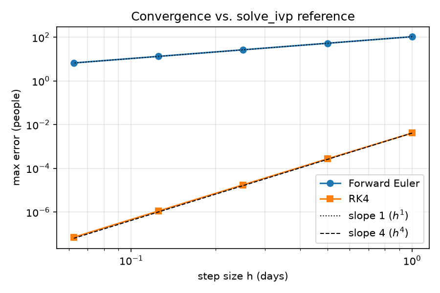
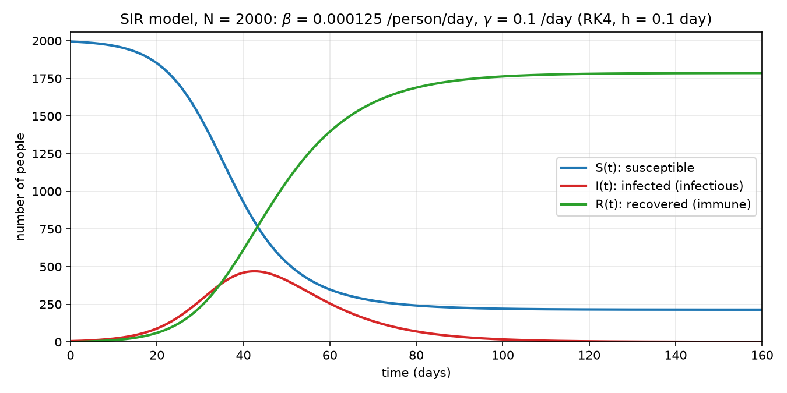
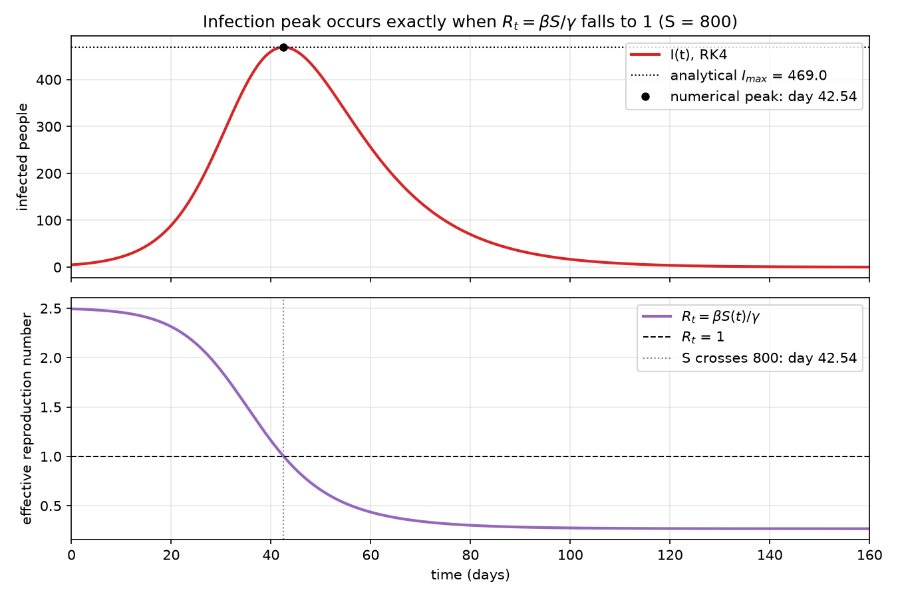
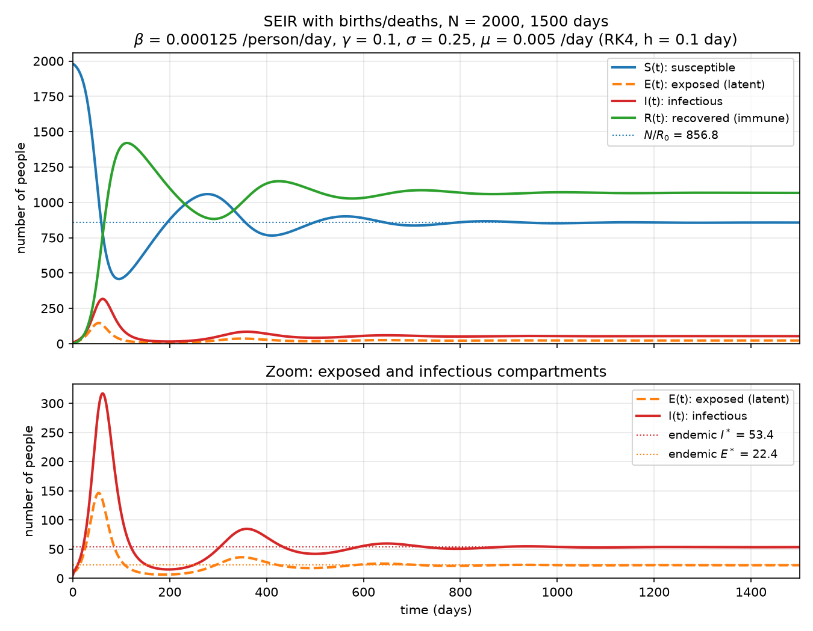
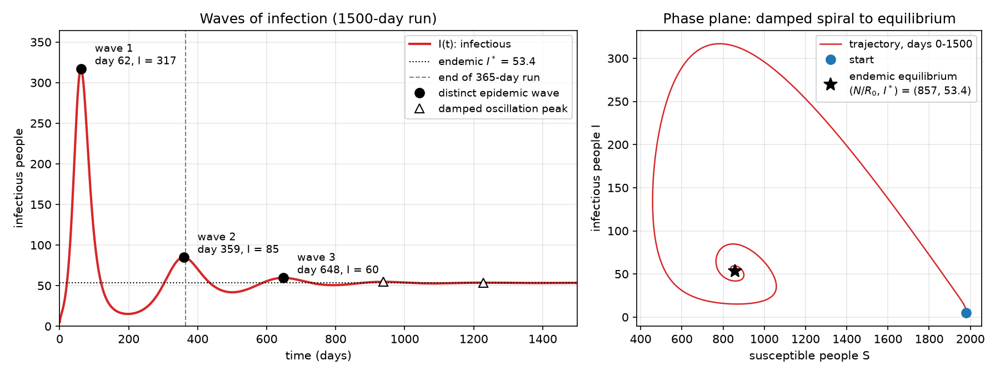
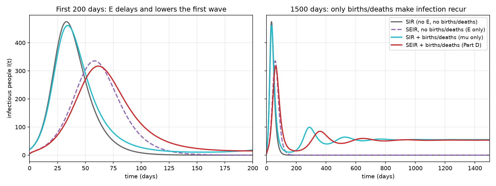
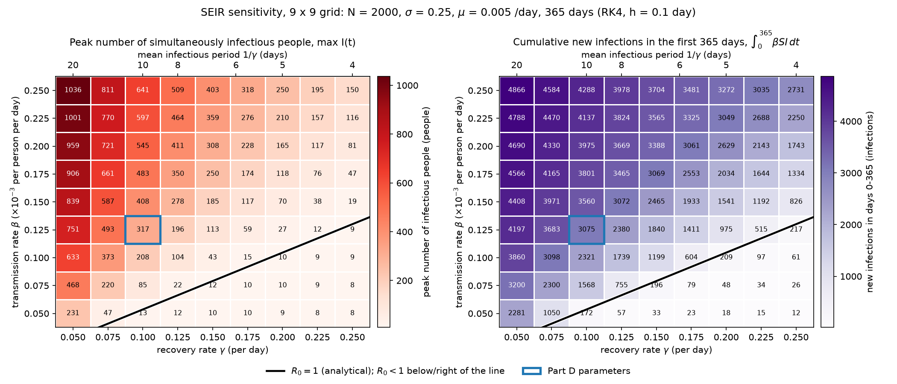
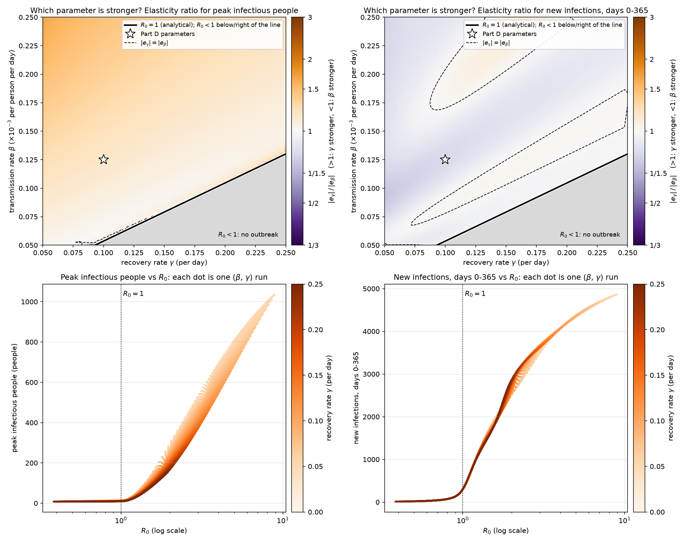

# SIR and SEIR Models of Pandemic Spread

**BMI 500 — Lecture 7: An Introduction to Model-based Machine Learning · Homework 1**

| | |
|---|---|
| **Student** | Sadeen Alsabbagh |
| **Email** | Sadeen.alsabbagh@emory.edu |
| **Question** | HW 1: SIR and SEIR Model Implementation for Pandemic Spread |

## Overview

This project implements the SIR and SEIR compartmental epidemic models with hand written ODE solvers and is organised in five parts:

| Part | Notebook | Content |
|---|---|---|
| A | [`partA_sir_solver.ipynb`](partA_sir_solver.ipynb) | Forward Euler and RK4 solvers; verification |
| B | [`partB_sir_simulation.ipynb`](partB_sir_simulation.ipynb) | 160-day SIR simulation |
| C | [`partC_sir_analysis.ipynb`](partC_sir_analysis.ipynb) | Infection peak, $R_0$, epidemic dynamics |
| D | [`partD_seir_model.ipynb`](partD_seir_model.ipynb) | SEIR with births and deaths; waves; endemic equilibrium |
| E | [`partE_sensitivity.ipynb`](partE_sensitivity.ipynb) | Sensitivity of the SEIR outcomes to $\beta$ and $\gamma$ |

The models and solvers live in one module, [`epimodels.py`](epimodels.py), which every notebook imports. Throughout,
results are labelled **[analytical]** (derived from the equations provided in the assignment sheet) or **[numerical]** (read from a simulation), so that each simulation result can be checked against what is theortical. All numbers below are copied from the frozen resutls in notebooks. 

---

## Mathematical models

### Compartments and parameters

| Symbol | Meaning | Units |
|---|---|---|
| $S$ | susceptible: can be infected | people |
| $E$ | exposed: infected, not yet infectious (SEIR only) | people |
| $I$ | infectious: currently able to transmit | people |
| $R$ | recovered: immune for life | people |
| $\beta$ | transmission rate (mass action, $S$ and $I$ are counts) | per person per day |
| $\gamma$ | recovery rate; $1/\gamma$ = mean infectious period | per day |
| $\sigma$ | rate of becoming infectious; $1/\sigma$ = mean latent period | per day |
| $\mu$ | per-capita birth rate = death rate; $1/\mu$ = mean lifespan | per day |

### SIR model (Parts A–C)

$$
\frac{dS}{dt}=-\beta SI,\qquad \frac{dI}{dt}=\beta SI-\gamma I,\qquad \frac{dR}{dt}=\gamma I,
\qquad R_0=\frac{\beta N}{\gamma}.
$$

### SEIR model with births and deaths (Parts D–E)

$$
\frac{dS}{dt}=\mu N-\beta SI-\mu S,\qquad
\frac{dE}{dt}=\beta SI-(\sigma+\mu)E,\qquad
\frac{dI}{dt}=\sigma E-(\gamma+\mu)I,\qquad
\frac{dR}{dt}=\gamma I-\mu R,
$$

$$
R_0=\frac{\sigma}{\sigma+\mu}\cdot\frac{\beta N}{\gamma+\mu}=\frac{\beta N\sigma}{(\sigma+\mu)(\gamma+\mu)}.
$$

The first factor of $R_0$ is the probability of surviving the latent period. The second is the number of infections
caused per day ($\beta N$) times the mean time spent infectious, $1/(\gamma+\mu)$.

**Births and deaths.** All newborns enter $S$ at the constant rate $\mu N$. Every compartment loses people to death at
rate $\mu$, which is unrelated to the disease. This turnover replaces immune people with susceptible newborns.

**Population conservation.** In SIR the three derivatives sum to zero, so $S+I+R=N$ exactly. In SEIR the disease flows
cancel, and the total $T=S+E+I+R$ obeys $dT/dt=\mu(N-T)$; since $T(0)=N$, the total stays at $N$. Both identities
are checked numerically in every notebook.

**Prevalence vs. incidence.** $I(t)$ is a *prevalence*: the number of people infectious **at time $t$**. The incidence
$\beta S I$ is the number of **new** infections per day (the $S\to E$ or $S\to I$ flow). Cumulative incidence is
$C(T)=\int_0^T\beta S I\,dt$. The peak of $I$ (Parts C–E) measures simultaneous burden; $C(T)$ (Part E) measures
total burden.

---

## Part A — Numerical solver

**Implementation** ([`epimodels.py`](epimodels.py)). A model is a right-hand-side function `rhs(t, y, params)`. The
one-step solvers know nothing about epidemics:

- **Forward Euler:** $y_{n+1}=y_n+h\,f(t_n,y_n)$, with global error $O(h)$.
- **Classical RK4:** four slope samples per step,
  $y_{n+1}=y_n+\tfrac{h}{6}(k_1+2k_2+2k_3+k_4)$, with global error $O(h^4)$.
- `simulate(rhs, y0, t_end, h, params, method)` marches either step from $t=0$ to $t_\text{end}$.

The SEIR model (Part D) therefore only needed a new right-hand side. `scipy.integrate.solve_ivp` is used **only** as an
independent reference.

**Verification** (Part B parameters, 160 days):

| Check | Result |
|---|---|
| Conservation, $\max\lvert S+I+R-N\rvert$ | RK4 $3.2\times10^{-12}$, Euler $2.7\times10^{-12}$ people (round-off) |
| Nonnegativity at $h=0.1$ | min = 0 for both; Euler first goes negative at $h=16$ days (−499.5) |
| Disease-free state $I(0)=0$ | no change (0.0) for both |
| $\beta=0$: exact $I_0e^{-\gamma t}$ | max error RK4 $1.6\times10^{-10}$, Euler $9.2\times10^{-3}$ people |
| Convergence order vs. `solve_ivp` (DOP853, tol $10^{-12}$) | Euler 1.00; RK4 3.92 → 3.98 as $h$ goes 1 → 0.0625 |
| Self-convergence (no SciPy), $h=0.2,0.1,0.05$ | Euler $p=1.00$; RK4 $p=3.98$ |
| Max error at $h=0.1$ vs. `solve_ivp` | **RK4 $4.6\times10^{-7}$ people**; Euler 10.7 people |

**Why RK4 with $h=0.1$ day.** At $h=0.1$, RK4 is accurate to well under $10^{-6}$ people. Euler at the same step is off
by about 11 people. A run takes a fraction of a second, so nothing is gained by a larger step. The choice was
re-checked for the longer SEIR runs (Part D: observed order 4.05, error $8.7\times10^{-8}$ people over 1500 days) and for
every parameter pair of Part E.

*Max error versus step size (log–log). The slopes match the theoretical orders 1 (Euler) and 4 (RK4).*

---

## Part B — SIR simulation

$N=2000$; $S(0)=1995$, $I(0)=5$, $R(0)=0$; $\beta=0.125\times10^{-3}$ per person per day; $\gamma=0.1$ per day;
160 days; RK4, $h=0.1$ day (1601 time points). Conservation: $\max\lvert S+I+R-N\rvert=3.2\times10^{-12}$; all
values nonnegative.

- **$S(t)$** falls monotonically ($dS/dt=-\beta SI\le0$). The fall is slow at first, fastest around the peak of $I$,
  then levels off at about 214.
- **$I(t)$** grows roughly exponentially, peaks near day 42.5 at about 469 people, then decays to 0.2 by day 160.
- **$R(t)$** rises in an S-shape to about 1786, lagging $I$ by roughly one infectious period ($1/\gamma=10$ days).

---

## Part C — SIR analysis

### C(i) Infection peak

**[analytical]** $dI/dt=I(\beta S-\gamma)$, so $I$ peaks exactly when
$S=S^*=\gamma/\beta=800$ people. Using the conserved quantity $V(S,I)=S+I-(\gamma/\beta)\ln S$:

$$
I_\text{max}=I_0+S_0-S^*-S^*\ln\frac{S_0}{S^*}=468.97\ \text{people}.
$$

**[numerical]** The peak is on **day 42.544**, with $I=$ **468.97** people (from a parabolic fit to the grid, confirmed
by the time $S$ crosses 800). This differs from the analytical height by $9.4\times10^{-6}$ people. A run with
$h=0.01$ gives the same day, and $V$ is conserved to $10^{-8}$.

**What sets the peak.**
- *Height* depends only on $S_0$, $I_0$ and $S^*=\gamma/\beta$. A larger $R_0$ means $S_0$ is further above the
  threshold, so more people are infectious at once.
- *Timing* depends on the early growth rate $r=\beta S_0-\gamma$ and on $I_0$.

### C(ii) Basic reproduction number

**[analytical]** $R_0=\beta N/\gamma=$ **2.50**: in a fully susceptible population, each case causes 2.5 new infections.

- **Growth:** the initial growth rate is $r=0.1494$/day (doubling time 4.64 days). The fitted slope of $\ln I$ over
  days 0–10 is 0.1481/day.
- **Decline:** the effective number $R_t=\beta S(t)/\gamma$ falls as susceptibles are used up. $I$ peaks when $R_t=1$.
- **Herd immunity:** the threshold is $1-1/R_0=60\%$.
- **Control:** $R_0<1$ requires either
  - $\beta<5\times10^{-5}$ (a 60 % cut in transmission), or
  - $\gamma>0.25$/day (infectious period under 4 days).

*Top: $I(t)$ with the analytical $I_\text{max}$. Bottom: $R_t$ crosses 1 on the same day (42.54) that $I$ peaks.*

### C(iii) Epidemic dynamics

| Quantity | Value |
|---|---|
| [numerical] $S(160)$: never infected by day 160 | **214.05** people (10.7 %) |
| [numerical] new infections by day 160, $S_0-S(160)$ | 1780.95 |
| [numerical] $I(160)$ | 0.208 |
| [analytical] $S_\infty$, from $\ln(S_0/S_\infty)=(\beta/\gamma)(N-S_\infty)$ | **213.98** people |
| [numerical] RK4 run to day 600 | $S=213.98$, matching $S_\infty$ |
| [analytical] overshoot $S^*-S_\infty$ | 586.0 people |

The epidemic ends because it runs out of *infectious* people, not because it runs out of *susceptible* people. After the
peak $R_t<1$, so each generation of cases is smaller than the last. However, the roughly 469 people infectious at the
peak still cause many infections. This pushes $S$ far below the threshold of 800 (the **overshoot**), and about 1786
people are eventually infected instead of the 1200 needed for herd immunity.

---

## Part D — SEIR model with births and deaths

**Changes from SIR.**
- An **exposed** compartment $E$ holds infected people who cannot yet transmit, for a mean of $1/\sigma=4$ days.
- **Demographic turnover** ($\mu$): births and deaths, as defined above.

**Parameters:**
- $N=2000$; $S(0)=1980$, $E(0)=15$, $I(0)=5$, $R(0)=0$.
- $\beta=0.125\times10^{-3}$, $\gamma=0.1$, $\sigma=0.25$, $\mu=0.005$ (all per day; per person per day for $\beta$).
- RK4, $h=0.1$; 365- and 1500-day runs.

**Checks:**
- Conservation to $7\times10^{-12}$ people; values strictly positive for $t>0$.
- Observed RK4 order 4.03–4.21.
- Agreement with `solve_ivp` to $7\times10^{-7}$ people over 1500 days.
- Stability margin $h\lvert\lambda\rvert=0.044$, far below the RK4 limit of about 2.8.

### D(iii) Epidemic waves

Distinct waves are maxima whose prominence is at least 20 % of their height; the detection was cross-checked with
SciPy's `find_peaks`.

| # | Peak day | Peak $I$ | New infections in the wave (window) | Type |
|---|---|---|---|---|
| 1 | 61.6 | 316.9 | 2181.8 (days 0–198) | epidemic wave |
| 2 | 359.2 | 84.8 | 1674.9 (days 198–500) | epidemic wave |
| 3 | 648.1 | 59.6 | 1661.1 (days 500–792) | epidemic wave |
| 4 | 938.0 | 54.7 | 1659.9 | damped oscillation (8 % prominence) |
| 5 | 1228.3 | 53.7 | 1660.7 | damped oscillation (2 %) |

- **The 365-day run** shows wave 1 and only the top of wave 2, which peaks six days before the end.
- **Spacing:** peaks are about 290 days apart (297.7, 288.8, 289.9, 290.3).
- **Damping:** each overshoot above equilibrium shrinks by a factor 0.12–0.22 per cycle. This approaches the
  linearisation prediction (period 290.5 days, amplitude factor 0.225 per cycle).

**Mechanism.** Wave 1 drives $S$ far below the threshold $N/R_0$. Births then refill $S$ at 10 per day; once $S$ exceeds
the threshold again, $R_t>1$ and a new wave starts. Because the response is delayed, the system overshoots repeatedly
and spirals into a stable **endemic equilibrium**.

### D(iv) Reproduction number and endemic equilibrium

**[analytical] $R_0=2.334$** (SIR: 2.50). The ratio $0.9337=\frac{\sigma}{\sigma+\mu}\cdot\frac{\gamma}{\gamma+\mu}=0.9804\times0.9524$
comes entirely from $\mu$: about 2 % of exposed people die before becoming infectious, and death shortens the infectious
period to 9.52 days. The latent period alone delays transmission but does not change $R_0$.

Setting all derivatives to zero with $I^*>0$:

| | Analytical equilibrium | RK4 at day 1500 |
|---|---|---|
| $S^*=N/R_0$ | **856.80** | 856.92 |
| $E^*$ | 22.42 | 22.44 |
| $I^*=\mu(N-S^*)/(\beta S^*)$ | **53.37** | 53.43 |
| $R^*$ | 1067.41 | 1067.20 |

**Meaning of $N/R_0$.** It is the threshold number of susceptibles at which $R_t=R_0S/N=1$. At equilibrium, infections
remove susceptibles exactly as fast as births add them, which forces $S\to N/R_0$. This is a **snapshot of the living
population**: about 857 people are susceptible *at any moment*, but the individuals change continuously. Newborns
enter, and susceptibles are infected or die. $S^*$ is therefore not a count of people who escape infection over their
whole life, nor of the original 1980 susceptibles. (With exponential lifetimes and a constant force of infection, the
lifetime escape probability $\mu/(\mu+\beta I^*)$ happens to equal $S^*/N\approx43\%$, but this is a property of this
model, not of the definition.) The immune fraction $1-1/R_0\approx57\%$ is the herd-immunity (vaccination) threshold.
In SIR, by contrast, $S$ ends far *below* $N/R_0$ (214 vs. 800), because nothing refills it.

### D(v) Exposed compartment vs. births and deaths

Each mechanism was switched on or off separately (1500 days, same $\beta,\gamma$; without $E$, the 15 exposed people
start as infectious):

| Model | First peak day | First peak $I$ | Number of peaks | $I(1500)$ |
|---|---|---|---|---|
| SIR (no $E$, no births/deaths) | 33.0 | 475.0 | 1 | $\approx0$ ($10^{-44}$) |
| SEIR, no births/deaths ($E$ only) | 58.2 | 335.4 | 1 | $\approx0$ ($10^{-38}$) |
| SIR + births/deaths ($\mu$ only) | 34.1 | 461.4 | 7 | 55.3 |
| SEIR + births/deaths (Part D) | 61.6 | 316.9 | 5 | 53.4 |

- **The exposed compartment changes timing.** It lengthens each generation of cases (about 14 instead of 10 days), so
  the first wave is later, lower and broader. Without demography it does not change $R_0$ or the outcome: one wave,
  and the infection disappears. It also delays the feedback between depletion and infection: $I$ peaks on day 61.6,
  after $S$ has already crossed $N/R_0$ on day 58.8.
- **Births and deaths decide whether infection persists.** Only the models with turnover show recurrent waves and an
  endemic state.

**The 200-day lifespan.** $\mu=0.005$/day means a mean lifespan of $1/\mu=200$ days, which replaces the population
within months; it was chosen so that the waves are visible. With a realistic 70-year lifespan ($\mu=3.9\times10^{-5}$/day):
- $R_0\to2.499$ and $N/R_0\to800.4$; the first wave is almost the SIR wave (day 58.2, 335 people).
- Linearisation predicts cycles of about 8.4 years, damped over about 64 years.
- The endemic level would be $I^*=0.47$, i.e. **less than one person**.
- After the first wave, the deterministic $I(t)$ falls to about $10^{-121}$. In reality the infection would **die out**
  in a population of 2000 unless it were re-introduced
  ([`partD_realistic_lifespan.png`](figures/partD_realistic_lifespan.png)).

---

## Part E — Sensitivity analysis

### Design

- **Grid.** $\beta\in\{0.05,0.075,\dots,0.25\}\times10^{-3}$ per person per day and $\gamma\in\{0.05,0.075,\dots,0.25\}$ per
  day: a **9 × 9 grid of 81 SEIR runs**. The step of 0.025 was chosen so that the Part D values are grid points.
- **Fixed:** $N=2000$, $\sigma=0.25$, $\mu=0.005$, the Part D initial conditions, 365 days, RK4 with $h=0.1$.
- **Fine grid.** An 81 × 81 grid (6561 runs) with the same `rk4_step`, used for contours and derivatives.
- **Outcomes:**
  1. peak prevalence $\max_t I(t)$;
  2. cumulative incidence $C(365)$, obtained by adding $dC/dt=\beta S I$ as a fifth ODE variable, which does not feed
     back into the model.

  $N-S(365)$ is **not** a valid count of infections when there are births and deaths. At the Part D point it gives 1170,
  whereas the correct total is 3075.

**Why $C(365)$ can exceed $N$.** Over the year, $\mu N\cdot365=3650$ newborns enter $S$, so infections are counted in
a population whose members change. Recovery is lifelong, so each infection event is a different person. $C(365)$ is
therefore the number of distinct people infected during the year (not counting the 20 already infected at $t=0$). It
is not the number of the *original* 2000 who were infected.

### Results

| Outcome (9 × 9 grid) | Minimum | Maximum | Part D point |
|---|---|---|---|
| $R_0$ [analytical] | 0.38 ($\beta=0.05$, $\gamma=0.25$) | 8.91 ($\beta=0.25$, $\gamma=0.05$) | 2.33 |
| Peak $I$ (people) | 8.0 | 1036.3 (52 % of $N$) | 316.9 (day 61.6) |
| $C(365)$ (infections) | 12.3 | 4866.1 | 3075.2 |
| Day of peak | 3.2 (no outbreak) | 173.8 ($R_0=1.23$) | 61.6 |

*Each cell is one simulation. The black line is the analytical boundary $R_0=1$; the blue outline marks the Part D
parameters. The top axis shows the infectious period $1/\gamma$.* Smooth contour versions with the peak day are in
[`partE_contours.png`](figures/partE_contours.png).

**The $R_0=1$ boundary**, $\beta^*(\gamma)=(\sigma+\mu)(\gamma+\mu)/(N\sigma)$, crosses the plotted region only partly. It
enters at $\gamma=0.093$ on the bottom edge and leaves at $\beta=0.130\times10^{-3}$ on the right edge. For $\gamma<0.093$
it lies below the $\beta$ range, so every cell there has $R_0>1$. Sixteen of the 81 cells have $R_0<1$.

**Why $I$ can rise even when $R_0<1$.** With $E(0)=15$, $dI/dt(0)=\sigma E(0)-(\gamma+\mu)I(0)=3.75-(\gamma+\mu)\cdot5>0$
for every $\gamma$ in the grid. So $I$ first rises from 5 to 8–13 as the initially exposed people become infectious.
This happens by day 10.5, after which $I$ decays ($I(365)<0.9$). This is a transient from the initial conditions, not an
outbreak. All 65 cells with $R_0>1$ peak on day 33 or later.

### Which parameter matters more?

$\beta$ and $\gamma$ have different units, so they are compared with **normalised sensitivities (elasticities)**,
$e_p=\partial\ln Y/\partial\ln p$: the percentage change in outcome $Y$ per 1 % change in parameter $p$. They are computed
by central differences at the Part D point (0.1 % step; a 1 % step agrees to 0.001). They are also compared over equal
fold-changes: $\beta\to\beta_0/f$ and $\gamma\to\gamma_0f$ with $f\in[0.5,2.5]$, which covers both assignment ranges exactly.

| Outcome | $e_\beta$ | $e_\gamma$ | $\lvert e_\gamma\rvert/\lvert e_\beta\rvert$ | Effect over the full range ($f=0.5\to2.5$) | Over the $R_0>1$ region of the 81 × 81 grid |
|---|---|---|---|---|---|
| **Peak $I$** | **+1.577** | **−1.835** | 1.163 | β: 641 → 13 (×48); **γ: 751 → 9.4 (×80)** | $\lvert e_\gamma\rvert>\lvert e_\beta\rvert$ in 99.6 % (median ratio 1.19) |
| **$C(365)$** | **+1.109** | **−0.896** | 0.808 | **β: 4288 → 172 (×25)**; γ: 4197 → 217 (×19) | $\lvert e_\gamma\rvert>\lvert e_\beta\rvert$ in only 24 % (median 0.95) |
| $R_0$ [analytical] | 1 | $-\gamma/(\gamma+\mu)=-0.952$ | 0.952 | — | — |

**Main result.** **$\gamma$ has the stronger effect on peak prevalence; $\beta$ has the stronger effect on cumulative
incidence.** Both parameters act mainly through $R_0\propto\beta/(\gamma+\mu)$, and $R_0$ is almost equally sensitive
to each. The difference for the peak comes from a second role of $\gamma$: $I$ is a prevalence, equal to the rate at
which people become infectious times how long they stay infectious, $1/(\gamma+\mu)$. A shorter infectious period lowers
the number of people infectious at once even at the *same* $R_0$. Among runs with $R_0\approx2.33$, the peak falls from
383 ($\gamma=0.05$) to 234 ($\gamma=0.205$). Cumulative incidence, by contrast, is almost a function of $R_0$ alone.

*Top: $\lvert e_\gamma\rvert/\lvert e_\beta\rvert$ (orange: γ stronger; blue: β stronger; grey: $R_0<1$). Bottom: peak
$I$ is not determined by $R_0$ alone (spread by γ), while $C(365)$ nearly is.* The one-at-a-time sweeps, including $I(t)$
curves and the peak day, are in [`partE_sweeps.png`](figures/partE_sweeps.png).

**Equal percentage changes** give a different-looking answer:

| Change at the Part D point | Peak $I$ | $C(365)$ |
|---|---|---|
| $\beta$ cut by 30 % | 146.6 | 1976 |
| $\gamma$ raised by 30 % | 176.3 | 2256 |
| $\beta$ cut by 50 % | 30.6 | 875 |
| $\gamma$ raised by 50 % | 113.0 | 1840 |

This is because a $x$ % cut is a larger *fold* change than an $x$ % increase: −50 % halves $\beta$, while +50 % multiplies
$\gamma$ by only 1.5. At equal fold changes, $\gamma$ lowers the peak more at every size tested (e.g. $\beta/1.3$ gives
189.1, $\gamma\times1.3$ gives 176.3). Elasticities are the unit-free and symmetric comparison.

**Nonlinear effects.**
- **Near the threshold** ($1<R_0<1.5$), the median elasticities of the peak are about +5.1 and −5.4. For $R_0>5$ they
  are only +0.5 and −0.7, because the outcomes saturate when susceptibles are exhausted.
- **Timing:** stronger interventions first delay the peak. Reducing $\beta$ moves it to about day 140, raising $\gamma$
  to about day 87. Below $R_0=1$, the peak collapses to the early transient.
- **Second waves within the year:** at high $\beta$, a second wave starts inside the 365 days, which adds to $C(365)$.

### Public-health implications

- **Transmission reduction ($\beta$; social distancing, masks, ventilation)** is the stronger lever for **total
  infections** and for **delaying** the peak, which buys time. From the Part D point, $R_0<1$ needs a 57.2 % reduction
  in $\beta$.
- **Faster recovery ($\gamma$; treatment that shortens infectiousness)** is, per fold change, the stronger lever for the
  **peak**, i.e. simultaneous burden and healthcare load. In this model, isolating cases also raises $\gamma$, but
  treatment that only relieves symptoms does not. $R_0<1$ by $\gamma$ alone would need $\gamma\geq0.240$/day
  (×2.4; infectious period under 4.2 days), which is hard to achieve medically.
- **Combined interventions multiply in $R_0$.** $\beta/1.25$ together with $\gamma\times1.25$ gives $R_0=1.51$, a peak of
  103.8 instead of 316.9, and 1739 instead of 3075 infections. Moderate combined measures can reach the region near
  $R_0=1$, where each further percent has the largest relative effect.

**Verification (Part E).**
- All 81 and all 6561 runs completed; every value is finite and nonnegative; conservation holds to $6\times10^{-12}$.
- The Part D point reproduces Part D: day 61.6, 316.92 people, and $C(365)=3075.25$ vs. 2181.8 + 893.5 from Part D's
  waves. The trajectory is bit-identical.
- $C(365)$ agrees three ways: RK4 counter, trapezoid rule, and the susceptible balance (all 3075.246).
- Smaller steps ($h=0.05$, 0.025) change $C(365)$ by less than $2\times10^{-7}$. The peak values change by
  $4\times10^{-3}$ people, which is time-sampling of the maximum: the trajectories agree to $3\times10^{-7}$.
- SciPy DOP853 agrees to within $4\times10^{-7}$ at six points.
- The $R_0=1$ line is exact to $2\times10^{-16}$ and matches the change of stability of the disease-free state.

---
## Hypothesis revisited

`hypothesis.pdf`

| Prediction | Observed | Verdict |
|---|---|---|
| **(i) Part B:** One infection peak around days 40–60, with 450–550 people infectious | Day **42.54**, **468.97** infectious people; one major wave | **Supported** |
| **(ii) Part D:** Several infection waves, with later waves becoming smaller | Three distinct waves (days 61.6, 359.2, 648.1), followed by damped oscillations toward $I^*=53.37$ | **Supported** |
| **(iii) Part E:** $\beta$ has a stronger effect on the infection peak than $\gamma$ | Peak elasticity: $e_\beta=+1.577$, $e_\gamma=-1.835$ | **Not supported for peak prevalence; partly supported for cumulative incidence** |

**Explanations.**

- **(i) SIR infection peak.** My prediction was based on the balance between transmission and recovery. Initially, $R_0=\beta N/\gamma=2.5>1$, so infections should increase while most of the population remains susceptible. From $dI/dt=I(\beta S-\gamma)$, the infectious population grows when $\beta S>\gamma$ and declines when $\beta S<\gamma$. The simulation confirmed that the peak occurs when $S=\gamma/\beta=800$, where new infections and recoveries balance. Both the observed peak day and height fall within my predicted ranges. The single-wave behavior was also expected because the SIR model has no mechanism for replenishing susceptible individuals.

- **(ii) SEIR infection waves.** I expected recurring waves because births continuously replenish the susceptible population, while the exposed compartment delays progression into infectiousness. The simulation showed three distinct waves of decreasing magnitude, followed by damped oscillations approaching an endemic equilibrium. The mechanism comparisons in Part D(v) clarified that introducing $E$ primarily delays and reduces the first peak, whereas demographic turnover allows susceptible replenishment and recurring infections. My expectation of smaller subsequent waves was supported, but the long-term behavior is more precisely described as convergence toward an endemic equilibrium rather than indefinitely recurring outbreaks of comparable size.

- **(iii) Parameter sensitivity.** I expected $\beta$ to dominate because it controls the rate of new exposures through $\beta SI$, which subsequently contribute to the infectious population. However, the experiments showed that $\gamma$ has the larger local effect on peak prevalence ($|e_\gamma|=1.835$ vs. $|e_\beta|=1.577$). My initial reasoning underestimated the importance of infectious duration: $\gamma$ controls how quickly individuals leave $I$, so it directly affects the number infectious simultaneously. The prediction was therefore not supported for the peak. However, $\beta$ had the larger local effect on cumulative incidence ($e_\beta=1.109$ vs. $|e_\gamma|=0.896$), partly supporting the broader expectation that transmission strongly influences the total number of infections.

**Overall.** The SIR and SEIR simulations supported my expectations about infection peaks and recurring waves, while the sensitivity analysis challenged my prediction about parameter importance. The main lesson is that the influence of a model parameter depends not only on its role in the differential equations, but also on the outcome being measured and the comparison used.

---

## Discussion and limitations

- **Deterministic model.** The ODEs allow fractions of people. In Part D with a realistic lifespan, $I$ falls to
  $10^{-121}$ people, and in Part E peaks near $R_0=1$ are only about 10 people. In both cases a stochastic model would
  predict extinction with substantial probability, so the deterministic recurrence and near-threshold results are upper
  bounds on persistence. A combination of both models could be an intresting experiment choice. 
- **Homogeneous mixing.** Subjects are treated as if they mix uniformly, without explicitly modeling a social network or spatial location.
- **Numerical accuracy is not real-world validity.** The solver error is below $10^{-6}$ people. Uncertainty in the
  model structure and parameters is many orders of magnitude larger. Verification shows that the equations were solved
  correctly, not that they describe a real epidemic. No model was fitted to data.
- **Sensitivity depends on the outcome and the metric.** γ is stronger for the peak and β for cumulative incidence.
  Equal-percentage and equal-fold comparisons rank them differently, and elasticities vary across the grid (about 5
  near $R_0=1$, below 1 at high $R_0$). The 365-day horizon also matters: near-threshold epidemics are unfinished, and
  high-$R_0$ ones include part of a second wave.
- **Fixed parameters.** σ, μ and the initial conditions were held fixed in Part E. The "peak" counts infectious people
  ($I$), not all infected people ($E+I$).

---

## Reproducing the results

**Requirements.** Python 3.11 (tested with 3.11.3) and the packages in [`requirements.txt`](requirements.txt): numpy,
scipy, matplotlib, jupyter. They were tested with numpy 1.26.4, SciPy 1.17.1 and matplotlib 3.11.2. SciPy is used only
for verification.

---

## AI use and disclosure

**Statement:** Generative AI was used in this homework. **ChatGPT** (OpenAI) was used for conceptual understanding, scientific discussion and prompt development to write jupyter notebooks and implement functions and visuals. I also used it for paraphrasing and formatting of my plotted and written results.

The full conversations are available at:
- ChatGPT: https://chatgpt.com/share/6ad2ae4f-f1c0-83ea-9561-15d7526d715a 
https://chatgpt.com/share/6ad2c185-81a4-83ea-8f54-e9e6a252969e
